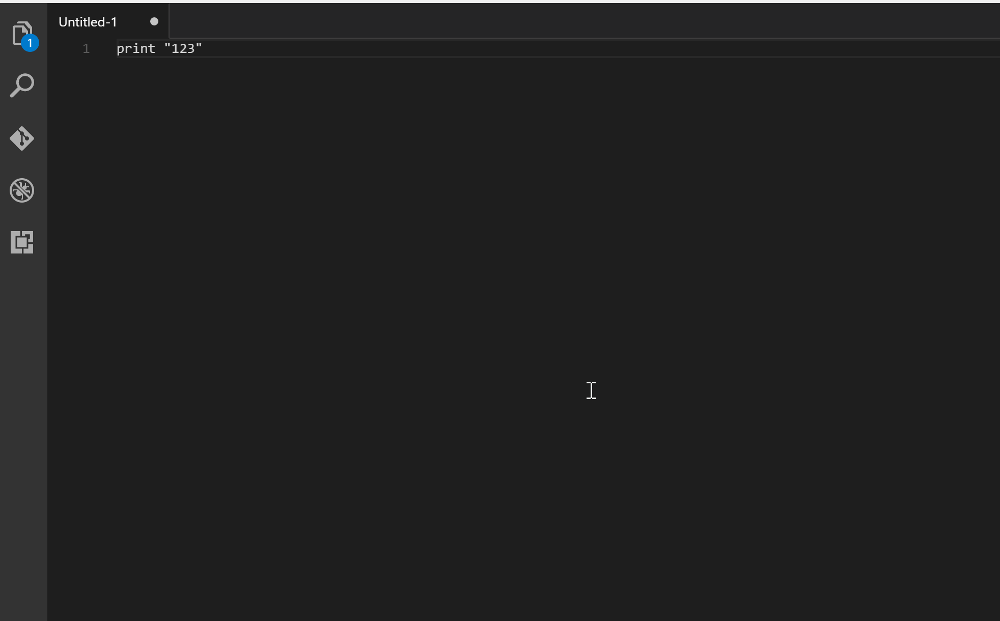

# Code Runner

[](https://marketplace.visualstudio.com/items?itemName=formulahendry.code-runner)
[](https://marketplace.visualstudio.com/items?itemName=formulahendry.code-runner)
[](https://github.com/formulahendry/vscode-code-runner/actions/workflows/main.yml)
[](https://gitter.im/formulahendry/vscode-code-runner)

Run code snippets or whole files for many languages — **C, C++, Java, JavaScript, PHP, Python, Perl, Ruby, Go, Lua, Groovy, PowerShell, BAT/CMD, BASH/SH, F# Script, F# (.NET Core), C# Script, C# (.NET Core), VBScript, TypeScript, CoffeeScript, Scala, Swift, Julia, Crystal, OCaml Script, R, AppleScript, Elixir, Visual Basic .NET, Clojure, Haxe, Objective-C, Rust, Racket, Scheme, AutoHotkey, AutoIt, Kotlin, Dart, Free Pascal, Haskell, Nim, D, Lisp, Kit, V, SCSS, Sass, CUDA, Less, Fortran, Ring, Standard ML, Zig, Mojo, Erlang, SPWN, Pkl, Gleam, Bun, Deno** — plus custom commands.

## Features

- Run the code file of the current active text editor.
- Run a code file from the Explorer context menu.
- Run a selected code snippet in the text editor.
- **Run code with custom command-line arguments** (`Ctrl+Alt+A`).
- **Interactive Status Bar item** to run or stop code with a single click.
- **Copy run command to clipboard** to inspect or test in external terminals.
- **Clear output channel** command.
- **Configurable process timeout** to prevent runaway loops.
- **Custom environment variables** support per workspace/project.
- Run code according to its [shebang](<https://en.wikipedia.org/wiki/Shebang_(Unix)>) line.
- Run code according to a filename glob.
- Run a custom command.
- Stop a running process.
- View output in the Output panel.
- Set a default language to run, or pick one per run.
- REPL-style workflows by running code in the Integrated Terminal.

## Usage

To run code, use any of:

- shortcut `Ctrl+Alt+N`
- `F1`, then select/type `Run Code`
- right-click the editor and choose `Run Code`
- the `Run Code` button in the editor title menu
- the `Run Code` button in the Status Bar
- the `Run Code` item in the Explorer context menu

To run code with arguments:

- shortcut `Ctrl+Alt+A`
- `F1`, then select/type `Run Code with Arguments`
- right-click the editor and choose `Run Code with Arguments`

To stop a running process:

- shortcut `Ctrl+Alt+M`
- `F1`, then select/type `Stop Code Run`
- the `Stop Code Run` button in the editor title menu
- the `Stop Code` button in the Status Bar
- right-click the Output panel and choose `Stop Code Run`


To pick a language per run, use `Ctrl+Alt+J` (or `F1` → `Run By Language`) and type/select a language id, e.g. `php`, `javascript`, `bat`, `shellscript`.



To run a custom command, use `Ctrl+Alt+K` (or `F1` → `Run Custom Command`).

To copy the resolved run command, use `F1` → `Copy Run Command`.

To clear the Code output channel, use `F1` → `Clear Output Channel`.

## Settings

Make sure every interpreter/compiler is on the system `PATH`, or point to it explicitly in `code-runner.executorMap`, e.g.:

```json
{
  "code-runner.executorMap": {
    "javascript": "node",
    "php": "C:\\php\\php.exe",
    "python": "python",
    "ruby": "C:\\Ruby23-x64\\bin\\ruby.exe",
    "go": "go run",
    "html": "\"C:\\Program Files (x86)\\Google\\Chrome\\Application\\chrome.exe\"",
    "java": "cd $dir && javac $fileName && java $fileNameWithoutExt",
    "c": "cd $dir && gcc $fileName -o $fileNameWithoutExt && $dir$fileNameWithoutExt"
  }
}
```

**Supported placeholders**

| Placeholder              | Description                                                       |
| ------------------------ | ----------------------------------------------------------------- |
| `$workspaceRoot`         | Path of the folder opened in VS Code                              |
| `$dir`                   | Directory of the file being run                                   |
| `$dirWithoutTrailingSlash` | Directory of the file being run, without a trailing slash       |
| `$fullFileName`          | Full name (path) of the file being run                            |
| `$fileName`              | Base name of the file being run, without the directory            |
| `$fileNameWithExt`       | Base name of the file being run (alias for `$fileName`)           |
| `$fileNameWithoutExt`    | Base name of the file being run, without its extension            |
| `$fileExt`               | File extension of the file without leading dot                    |
| `$relativeFile`          | Path of the file relative to the workspace root                   |
| `$relativeDir`           | Directory of the file relative to the workspace root              |
| `$cwd`                   | Configured working directory                                      |
| `$driveLetter`           | Drive letter of the file being run (Windows only)                 |
| `$pythonPath`            | Python interpreter path (set via `Python: Select Interpreter`)    |
| `$args` / `$arguments`   | Command-line arguments passed when running with arguments         |
| `$env:VAR` / `${env:VAR}`| Value of environment variable `VAR`                              |

> **Note about paths:** escape backslashes as `\\` and wrap paths containing spaces in `\"`.

You may also set executors by filename [glob](https://en.wikipedia.org/wiki/Glob_(programming)):

```json
{
  "code-runner.executorMapByGlob": {
    "pom.xml": "cd $dir && mvn clean package",
    "*.test.js": "tap",
    "*.js": "node"
  }
}
```

or by file extension:

```json
{
  "code-runner.executorMapByFileExtension": {
    ".vbs": "cscript //Nologo"
  }
}
```

Set a default language to run:

```json
{
  "code-runner.defaultLanguage": "javascript"
}
```

Set the custom command:

```json
{
  "code-runner.customCommand": "echo Hello"
}
```

Set the working directory:

```json
{
  "code-runner.cwd": "path/to/working/directory"
}
```

Other useful options (all `"code-runner.<name>"` settings):

| Setting                    | Default    | Description                                                        |
| -------------------------- | ---------- | ------------------------------------------------------------------ |
| `clearPreviousOutput`      | `false`    | Clear previous output before each run                              |
| `saveAllFilesBeforeRun`    | `false`    | Save all files before running                                      |
| `saveFileBeforeRun`        | `false`    | Save the current file before running                               |
| `showExecutionMessage`     | `true`     | Show `[Running] ...` / `[Done] ...` messages                       |
| `runInTerminal`            | `false`    | Run code in the Integrated Terminal (REPL support)                 |
| `preserveFocus`            | `true`     | Keep focus on the editor after starting a run                      |
| `ignoreSelection`          | `false`    | Ignore the selection and always run the whole file                 |
| `fileDirectoryAsCwd`       | `false`    | Use the directory of the file as the working directory             |
| `showRunIconInEditorTitleMenu` | `true` | Show the `Run Code` icon in the editor title menu                  |
| `showRunCommandInEditorContextMenu` | `true` | Show `Run Code` in the editor context menu                 |
| `showRunCommandInExplorerContextMenu` | `true` | Show `Run Code` in the Explorer context menu               |
| `showStopIconInEditorTitleMenu` | `true` | Show `Stop Code Run` icon in the editor title menu           |
| `showRunButtonInStatusBar` | `true`     | Show `Run Code` / `Stop Code` button in the status bar             |
| `timeout`                  | `0`        | Process timeout in milliseconds (0 disables timeout)               |
| `customEnv`                | `{}`       | Custom environment variables passed to the execution               |
| `terminalRoot`             | `""`       | Replace Windows drive letters for Bash/Cygwin terminals            |
| `temporaryFileName`        | `tempCodeRunnerFile` | File name used for selected-snippet runs                  |
| `respectShebang`           | `true`     | Respect a shebang line when choosing how to run                    |
| `enableAppInsights`        | `true`     | Opt in/out of telemetry (see below)                                |

### About the current working directory

1. If `code-runner.cwd` is set, use it.
2. Otherwise, if `code-runner.fileDirectoryAsCwd` is `true`, use the directory of the file being run.
3. Otherwise, use the root folder open in VS Code.
4. If no folder is open, use the OS temporary directory.

## Notes

- Objective-C is supported on macOS only.
- C# script support requires [scriptcs](http://scriptcs.net/).
- TypeScript support requires [ts-node](https://github.com/TypeStrong/ts-node).
- Clojure support requires [Leiningen](https://leiningen.org/) and [lein-exec](https://github.com/kumarshantanu/lein-exec).

## Telemetry

This extension collects usage data by default to help improve it. Telemetry is sent through the official `@vscode/extension-telemetry` module and automatically respects the global `telemetry.telemetryLevel` setting. It can also be disabled per extension:

```json
{
  "code-runner.enableAppInsights": false
}
```

## Development

Requirements: Node.js 20+.

```sh
npm install          # install dependencies
npm run compile      # type-check + bundle (esbuild) into dist/
npm run watch        # watch mode
npm run lint         # eslint
npm test             # run unit tests (vitest) across platforms
```

## Change Log

See [CHANGELOG.md](CHANGELOG.md).

## Issues

Report bugs or request features in the [issue tracker](https://github.com/formulahendry/vscode-code-runner/issues).

## Contribution

Fork the [repository](https://github.com/formulahendry/vscode-code-runner) and submit pull requests.